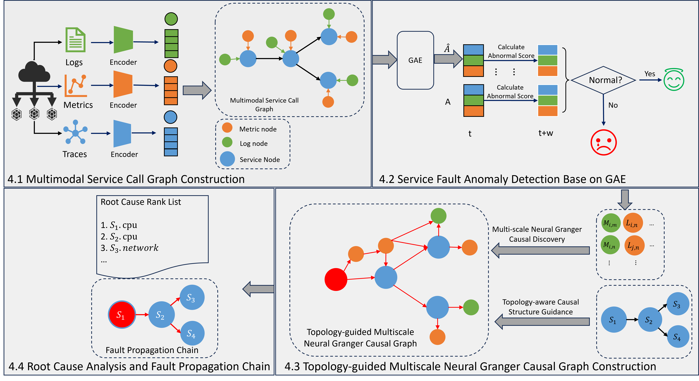

# TCRCA: Topology-Guided Causal Inference for Root Cause Analysis in Microservices

Official reference implementation for the TCRCA paper — a topology-guided causal inference framework for root cause analysis in microservices.

## Overview

TCRCA is a comprehensive approach that combines multiple advanced techniques:

- **Multi-modal Service Call Graph (MSCG)** — builds rich service dependency representations
- **Graph Autoencoder (GAE)** — performs unsupervised anomaly detection
- **Multi-scale Topology-Guided Inference (MS-TGI)** — learns causal relationships guided by service topology
- **Failure Propagation Graphs (FPG)** — outputs interpretable failure propagation paths
- **Anomaly-aware Causal Path Search (A-CPS)** — ranks root causes with explainable paths

[](https://www.python.org/downloads/)
[](https://pytorch.org/)

**[Installation](#installation) · [Datasets](#datasets) · [Metrics](#evaluation-metrics) · [Quick Start](#quick-start) · [Citation](#citation)**




---

## 1. Method overview

TCRCA is a four-stage pipeline.  Each stage maps to one paper section and one
package subdirectory:

| Stage | Paper section | Equations | Implementation |
|---|---|---|---|
| MSCG encoding | IV-B | Eq. (7)-(17) | [`tcrca/encoders/`](tcrca/encoders) |
| Anomaly detection | IV-C | Eq. (18)-(23) | [`tcrca/models/gae.py`](tcrca/models/gae.py) |
| Causal inference (MS-TGI) | IV-D | Eq. (24)-(29) | [`tcrca/models/mstgi.py`](tcrca/models/mstgi.py) |
| Root-cause diagnosis (FPG + A-CPS) | IV-E | Eq. (30)-(35), Algorithm 1 | [`tcrca/models/fpg.py`](tcrca/models/fpg.py) |
| Evaluation | V | Eq. (38)-(39) | [`tcrca/evaluation/`](tcrca/evaluation) |


The implementation follows the paper's trace-level definition:

* one execution trace = one graph `T = (V, E, X)`;
* nodes `V` = services observed in that trace;
* edges `E` = caller -> callee invocation relationships;
* node features `X_i = {L_i, M_i, s_i}` combine log, metric and span evidence
  (Eq. 13);
* metric and log observations come from a trailing `w`-minute window ending at
  the trace end, resampled to `T` equal time bins;
* span features come from the spans belonging to the same trace;
* the historical normal set `W` is built only from normal traces, as required
  by Eq. (1)-(3).


`TCRCAModel.forward_trace` runs one trace graph through:

1. MSCG encoder: Hawkes log intensity (Eq. 7-8), multi-scale metric Transformer
   with scale fusion (Eq. 9-11), span MLP (Eq. 12), concatenation into `x_i`
   (Eq. 13);
2. GAT branch (Eq. 14-17) producing the trace representation `h_g`;
3. GAE: `H = GCN(X, A)` over the Eq. (13) features, decoding adjacency
   (Eq. 19) and `X` (Eq. 20), giving node scores `s_i` (Eq. 21-22) and trace
   score (Eq. 23);
4. MS-TGI: multi-scale Granger-style attention with the soft topology prior,
   fused into `A_causal` (Eq. 24-27) and scored by `RScore` (Eq. 33);
5. FPG construction and A-CPS path search (Eq. 30-35, Algorithm 1).

`V_anom` is used exactly as defined, `{i : s_i > tau}`: if no node exceeds
`tau`, the FPG and its root ranking are empty and A-CPS is not run. A-CPS
reuses the same `tau` and `theta` (`A_uv >= theta`, `s_u >= tau`) and collects
every popped path, including the initial single-node path.

The full equation-to-code map is in [Section 3](#3-equation-to-code-map).


## 2. Project structure

```
TCRCA/
├── tcrca/                          # Core package
│   ├── __init__.py                 # Exports TCRCAConfig
│   ├── config.py                   # Hyperparameters next to paper notation
│   ├── schemas.py                  # TraceGraph, FaultCase, PreparedData, TCRCAOutput, FPGResult
│   ├── pipeline.py                 # Trainer, tau calibration, checkpoint save/load
│   ├── utils.py                    # Seeding, device resolution, logging, JSON/Parquet helpers
│   ├── data/
│   │   ├── snapshot.py             # Read-only snapshot loader + Parquet cache
│   │   ├── logs.py                 # Drain3 + FastText (fitted on normal logs only)
│   │   └── dataset.py              # Per-trace graphs, normal topology, fault-case selection
│   ├── encoders/
│   │   ├── hawkes.py               # Eq. (7)-(8): Hawkes intensity sequence
│   │   ├── metrics.py              # Eq. (9)-(11): multi-scale metrics + fusion
│   │   ├── spans.py                # Eq. (12): span feature MLP
│   │   ├── logs.py                 # Log branch: Hawkes + template embedding
│   │   ├── mscg.py                 # Eq. (13): x_i = [x_log; x_metric; x_span]
│   │   └── gat.py                  # Eq. (14)-(17): GAT layers + attention pooling
│   ├── models/
│   │   ├── gae.py                  # Eq. (18)-(23): GCN encoder, decoders, anomaly score
│   │   ├── mstgi.py                # Eq. (24)-(29): causal adjacency, RScore, losses
│   │   ├── fpg.py                  # Eq. (30)-(35), Algorithm 1: FPG and A-CPS
│   │   └── tcrca.py                # End-to-end forward_trace
│   └── evaluation/
│       ├── metrics.py              # Eq. (38)-(39): A@k and Avg@k
│       └── runner.py               # Case-by-case evaluation and summary
├── scripts/
│   ├── train.py                    # Train on normal data, save checkpoint, evaluate
│   ├── evaluate.py                 # Evaluate a saved checkpoint
│   └── run_experiments.py          # Ablations
├── img/
│   └── architecutre.png            # System architecture diagram
├── pyproject.toml                  # Package metadata and pytest config
├── requirements.txt                # Runtime + test dependencies
├── .gitignore
└── README.md
```

Runtime directories (created on demand, safe to delete):

| Directory | Content |
|---|---|
| `.cache/` | Parsed `traces/`, `logs/`, `metrics/` Parquet tables and `log_model/` |
| `artifacts/` | Checkpoints written by `scripts/train.py` |
| `results/` | JSON and printed tables from `scripts/run_experiments.py` |

---

## 3. Equation-to-code map

| Paper item | Meaning | Implementation |
|---|---|---|
| Eq. (1)-(3) | trace graph and normal-trace baseline `W` | [`tcrca/data/dataset.py`](tcrca/data/dataset.py), `build_trace_graphs` |
| Eq. (4) | trace-level anomaly task | [`tcrca/models/tcrca.py`](tcrca/models/tcrca.py), `TCRCAModel.forward_trace` |
| Eq. (5)-(6) | learned causal adjacency and propagation path | [`tcrca/models/mstgi.py`](tcrca/models/mstgi.py), [`tcrca/models/fpg.py`](tcrca/models/fpg.py) |
| Eq. (7) | Hawkes intensity `lambda_i(t)` | [`tcrca/encoders/hawkes.py`](tcrca/encoders/hawkes.py), `HawkesEncoder.forward` |
| Eq. (8) | log representation `x_log` | [`tcrca/encoders/logs.py`](tcrca/encoders/logs.py), `LogEncoder`: per-event `[lambda_i(t_k); template_embedding]` sequence encoded by a Transformer |
| Eq. (9) | multi-scale resolutions `S={1,s,...,s^m}` | [`tcrca/encoders/metrics.py`](tcrca/encoders/metrics.py), scale loop |
| Eq. (10) | average pooling + Transformer per scale | same file, `MetricEncoder.forward` |
| Eq. (11) | scale fusion `h_metric = sum_s w_s h^(s)` | same file, `fusion_logits` / `softmax` |
| Eq. (12) | two-layer span MLP | [`tcrca/encoders/spans.py`](tcrca/encoders/spans.py) |
| Eq. (13) | `x_i = [log; metric; span]` | [`tcrca/encoders/mscg.py`](tcrca/encoders/mscg.py) |
| Eq. (14)-(15) | GAT message passing | [`tcrca/encoders/gat.py`](tcrca/encoders/gat.py), `GATLayer` |
| Eq. (16)-(17) | attention pooling `h_g` | same file, `GATEncoder.forward` |
| Eq. (18) | GCN encoder `H = GCN(X, A)`, depth `gnn_layers` | [`tcrca/models/gae.py`](tcrca/models/gae.py), `GCNLayer` |
| Eq. (19) | structure decoder `sigmoid(H W_s H^T)` | same file, `structure_weight` |
| Eq. (20) | attribute decoder MLP | same file, `attribute_decoder` |
| Eq. (21) | `lambda_s BCE + lambda_f ||X-X_hat||_F^2` | same file, loss block |
| Eq. (22) | node anomaly score with `alpha=0.6` | same file, `node_anomaly` |
| Eq. (23) | trace anomaly = node maximum | same file, `trace_anomaly` |
| Eq. (24) | `e_ij^(s) = MLP(h_i^(s) || h_j^(s))` | [`tcrca/models/mstgi.py`](tcrca/models/mstgi.py), `pair_mlp` |
| Eq. (25) | `softmax_j e_ij^(s)` | same file, attention computation |
| Eq. (26) | soft topology prior `(1 + gamma A_topo) * e` | same file, `biased` |
| Eq. (27) | `A_causal = sum_s w_s alpha~`, `sum w_s = 1` | same file, `fusion_logits` |
| Eq. (28) | `L_task + lambda_1 L_sparse + lambda_2 L_topo` | same file, loss block |
| Eq. (29) | `KL(Softmax(RScore) || Softmax(s_anomaly))` | same file, `loss_task` |
| Eq. (30)-(32) | FPG node and edge sets | [`tcrca/models/fpg.py`](tcrca/models/fpg.py), `build_fpg` |
| Eq. (33) | `RScore_i = sum_{j in V_anom} A_ij s_j` | [`tcrca/models/mstgi.py`](tcrca/models/mstgi.py), `compute_root_scores` (training); [`tcrca/models/fpg.py`](tcrca/models/fpg.py), `build_fpg` (inference) |
| Eq. (34) | top-k candidate roots | [`tcrca/models/fpg.py`](tcrca/models/fpg.py), `root_top_k` |
| Eq. (35) | path score `sum A_uv s_v` | same file, `run_acps` |
| Eq. (36)-(37) | topology regularization / FPR analysis | `L_topo` in `mstgi.py`; Eq. (37) is a theoretical bound, not a runnable module |
| Eq. (38)-(39) | A@k and Avg@k | [`tcrca/evaluation/metrics.py`](tcrca/evaluation/metrics.py) |
| Algorithm 1 | A-CPS backward path search over `A_causal` with the shared `theta` / `tau` | [`tcrca/models/fpg.py`](tcrca/models/fpg.py), `run_acps` |


## Datasets

TCRCA supports two public benchmarks for evaluation:

| Benchmark | Type | Description | Data Source |
|-----------|------|-------------|-------------|
| **Train Ticket** | Controlled Testbed | Chaos injection with OpenTelemetry traces and trace-level root labels | [FudanSELab/train-ticket](https://github.com/FudanSELab/train-ticket) |
| **AIOps Live Benchmark** | Real-world Workload | Large-scale cloud workload data | [aiops.cn — AIOps Live Benchmark](https://www.aiops.cn/aiops-live-benchmark) |

### Dataset Directory Structure

Both datasets use the same multi-modal layout. Place exports under:

- `datasets/train_ticket/` for Train Ticket
- `datasets/aiops_live/` for AIOps Live Benchmark

```
<dataset_root>/
└── data/
    ├── service_dependencies.json     # Optional; same JSON schema as Train Ticket
    └── <snapshot>/                   # Train Ticket: TT.* ; AIOps: any folder name
        ├── spans.json                # Distributed trace spans
        ├── logs.json                 # Service logs
        └── metrics/                  # Time-series metrics
            ├── ts-<service>-service.csv
            └── ...
```


---

## 5. Install and run

### 5.1 Environment

Python 3.10+ and the packages in `requirements.txt`:

```bash
cd TCRCA_Paper
python -m venv .venv
.venv\Scripts\activate          # Windows
# source .venv/bin/activate     # Linux / macOS
pip install -r requirements.txt
```

Run commands from inside `TCRCA_Paper` so that the local `tcrca` package is
imported rather than any legacy package with the same name.

### 5.2 Train and evaluate

```bash
python scripts/train.py --epochs 50 --seed 42
python scripts/evaluate.py --checkpoint artifacts/tcrca.pt
```


### 5.3 Ablations and RQ4 sweep

```bash
python scripts/run_experiments.py \
  --seeds 42,43,44,45,46 \
  --epochs 50 \
  --output results/experiments.json

python scripts/run_experiments.py --seeds 42 --sweeps "Time Window" --output results/window.json
```

This prints one mean +/- std table per selected group (A@1 ... A@5, Avg@5,
latency) and writes `{"ablations": ..., "sweeps": ...}` to the output file.
`--sweeps` selects groups; `--variants` selects ablation rows.

| Sweep group | Paper labels | Config values |
|---|---|---|
| `Time Window` | `TW=2/4/6/8/10` | `feature_window_minutes = 10/20/30/40/60` |
| `Scale \|S\|` | `S=2/4/8/16` | `metric_num_scales = 2/4/8/16` |
| `GNN Layers` | `L=2/3/4` | `gnn_layers = 2/3/4` (Eq. 18 GCN depth) |
| `Gamma` | `gamma=0.05/0.1/0.2` | `gamma_topo = 0.05/0.1/0.2` |

The Time Window labels follow the paper for comparability; the actual window
lengths are scaled to this trace-level implementation. Each window value
rebuilds the trace graphs once and is reused across seeds. Scale factors
coarser than `metric_steps` saturate at full-window mean pooling, so `S=16`
remains well defined with the default `metric_steps=128`.

| Ablation | Config change |
|---|---|
| `full` | None |
| `wo_tg` | `ablate_topology=True` (gamma = 0, lambda_2 = 0, dense all-pairs candidates) |
| `wo_mf` | `ablate_multimodal=True` (metric features only) |
| `wo_mt` | `ablate_multiscale=True` (single metric scale) |
| `wo_propagation` | `ablate_propagation=True` (rank by `s_i`, `anomaly` mode) |

The RQ4 group `GNN Layers` sweeps `L=2/3/4` over the Eq. (18) GCN depth
(`gnn_layers`); the main setting is `L=3`, matching the paper's Fig. 4
optimum.  `--variants ""` runs only the sweep, and `--sweeps ""` runs only the
ablations.


## 9. Citation

```bibtex
@article{tcrca2026,
  title   = {Topology-Guided Causal Inference for Root Cause Analysis in Microservices},
  author  = {Li, Junjun and Ying, Shi},
  journal = {IEEE Transactions on Software Engineering},
  year    = {2026},
}
```
